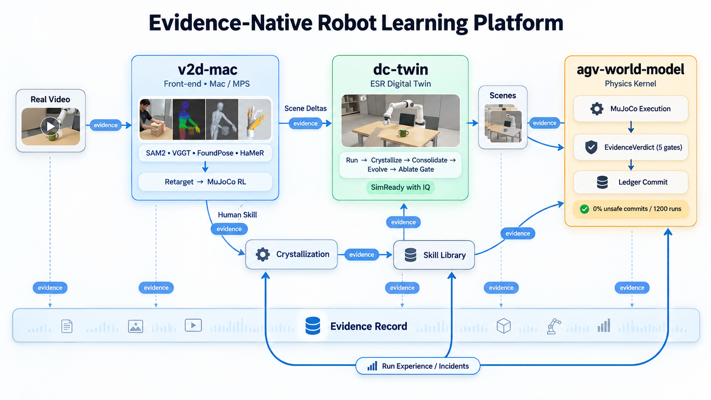

# v2d-mac

> **语言 / Language:** 中文为主 · English overview follows。

Evidence-native **Video → Data → Policy** pipeline on Apple Silicon (MPS/Metal, no CUDA) —— NVIDIA Isaac `video_to_data` 的 Mac 移植与证据化重构。

**English:** a Mac-native port of NVIDIA's V2D pipeline (human demonstration video → simulation-ready robot training data → RL policy), rebuilt around evidence-gated acceptance: every gate threshold frozen, every artifact provenance-stamped, honest FAIL preferred over a fake green.

*架构图由 GPT 作为架构评审伙伴共同绘制（co-designed with GPT as architecture reviewer）。*

## 六段管线 = 六个 smoke 关卡

| # | 段 | 回答的问题 | 状态（P0） |
|---|---|---|---|
| 1 | SAM2 MPS | 盒子在每帧哪里 | ✅ 绿 |
| 2 | VGGT-mps | 3D 结构对不对（重投影 1.87px 中位） | ✅ 绿 |
| 3 | FoundPose MPS | 盒子 6-DoF 位姿（诚实短板：轴向 41°，仅作 estimated） | ✅ 绿 |
| 4 | HaMeR MPS | 人手 22 关节位姿（MPS 39× 加速） | ✅ 绿 |
| 5 | dex-retarget | 人手动作 → Allegro 机械手 | 🟡 12/13（根因已修：锚点盲区 76mm） |
| 6 | MuJoCo PPO | 机器人策略真抓取 | 🔴 诚实 FAIL（场景几何瓶颈，standoff 修复验证中） |

## 证据门控方法论

- **阈值冻结**：验收门数值改动必须留痕；MJCF 产物盖 provenance 印章（工作区漂移拒盖）。
- **诚实 FAIL**：不换 episode、不放宽门、不造数据。本月在管线中杀掉 **6 个假绿**（检测器与 MPS 同错 / pedestal 接触冒充手接触 / 弹射冒充抬升 / 压住冒充抓取 / 棱边撬冒充提升 / **基座承重冒充手承重**——奖励按抬升付费时 42° 角楔也能交抬升分，A3b 的本意已写进目标函数 `W_PEDESTAL_LOAD`）。
- **修订记账**：每次物理修订（Wave 3 / 3.5）附实测依据 + 回归测试 pin，见 `grounding/assets/REVISION.md`；奖励修订（Wave 3.5-G）附实测承重分解 + `tests/test_smoke4_reward.py::R7*` 与 `tests/test_smoke4_pedestal_load.py` 的 pin。

## P1 升级（已批准）

- 接触一致 retarget（C2Dex 思路，物体坐标系接触槽位 + HaMeR 置信度加权）
- 残差 RL 训练架构（LAMP / Residual-RL，动作 = 相对参考运动的偏移，目标：样本数 < 1/4）
- DexMimicGen 式示范扩增、SmolVLA 底座（no-CUDA 约束下的 VLA 路线）

详见 `PLAN.md` §P1 升级设计。

## TopPrism 集成

与 [agv-world-model](https://github.com/topprismdata/agv-world-model)（物理证据门控世界模型）和 [dc-twin](https://github.com/topprismdata/dc-twin)（ESR 自进化数字孪生）的结合蓝图、分阶段落地与证据 schema 草案：**[docs/topprism_integration.md](docs/topprism_integration.md)**。

## 文档

- `DESIGN.md` — 签字稿（P0 六绿 smoke 设计）
- `PLAN.md` — 波次计划 + P1 衔接备注 + P1 升级设计
- `docs/topprism_integration.md` — 集成蓝图与证据 schema 草案
- `grounding/assets/REVISION.md` — MJCF 修订记账
